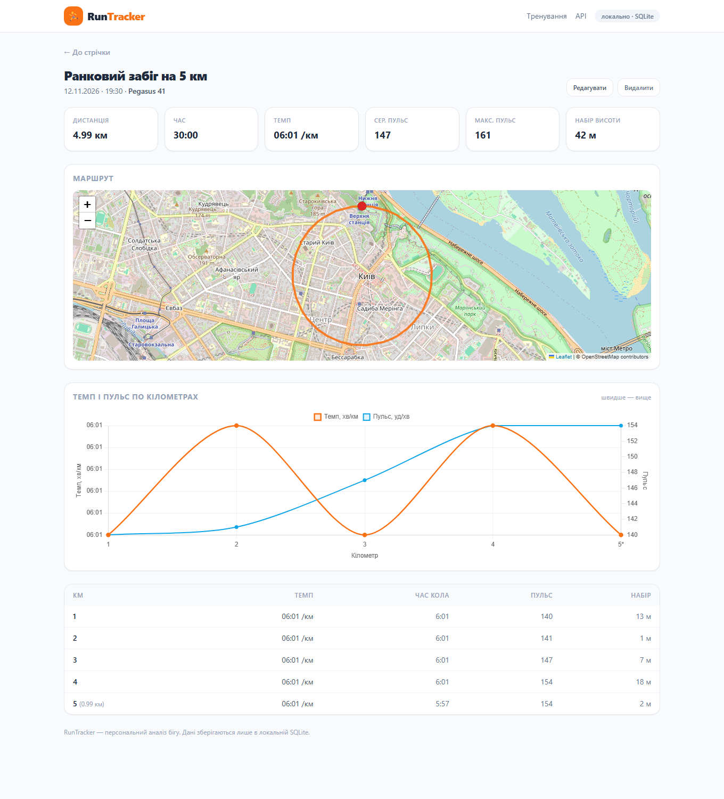
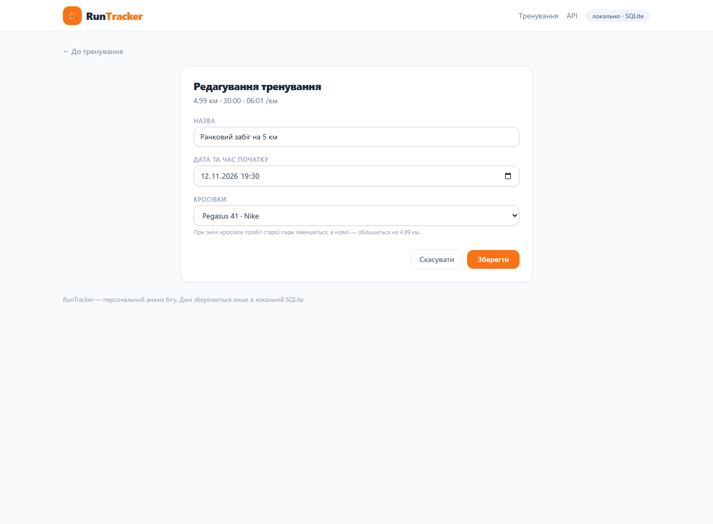

# RunTracker 🏃

Локальний веб-додаток для аналізу бігових тренувань — персональний аналог Strava
без підписок і хмари. Усі дані лежать у SQLite на твоєму комп'ютері.




## Стек

- **Python 3.11+**, **FastAPI**, **SQLAlchemy 2.x**, **SQLite**
- **Jinja2** + чистий HTML/CSS/JS
- **Tailwind CSS** (CDN) — верстка
- **Leaflet.js** — карта маршруту
- **Chart.js** — графік темпу та пульсу по кілометрах
- **gpxpy** / **fitdecode** — розбір файлів `.gpx` та `.fit`

## Швидкий старт (Windows, один клік)

Двічі клікни **`start.bat`** у корені проєкту — він:

1. за потреби створить `.venv` і встановить залежності;
2. відкриє <http://127.0.0.1:8000> у браузері за замовчуванням;
3. запустить сервер з autoreset (`uvicorn app.main:app --reload`), консоль
   залишиться відкритою для логів.

Або вручну:

```powershell
cd runtracker
python -m venv .venv
.venv\Scripts\pip install -r requirements.txt
.venv\Scripts\python -m uvicorn app.main:app --reload
```

Застосунок стартує **порожнім** — жодних демо-тренувань чи демо-кросівок.

## Структура

```
runtracker/
├── app/
│   ├── __init__.py
│   ├── db.py             # engine, session, init_db + легкі міграції
│   ├── models.py         # ORM: Activity (з file_hash), Shoe
│   ├── parser.py         # GPX/FIT → точки, спліти, середній темп
│   └── main.py           # роути: upload, CRUD, статистика, експорти
├── templates/
│   ├── base.html
│   ├── index.html        # статистика, upload, кросівки, стрічка, експорт
│   ├── activity.html     # карта, графік (інвертована вісь темпу), спліти
│   ├── activity_edit.html
│   └── shoe_edit.html
├── static/
│   ├── style.css
│   └── app.js            # drag & drop
├── sample_data/
│   ├── sample_run.gpx    # приклад GPX (5 км, 30 хв, пульс, висота)
│   └── sample_run.fit    # той самий трек у FIT
├── tools/
│   ├── make_samples.py   # генератор прикладів
│   └── smoke_test.py     # end-to-end тест (52 перевірки)
├── uploads/              # оригінальні завантажені файли
├── start.bat             # запуск у один клік
├── requirements.txt
└── runtracker.db         # створюється автоматично при першому запуску
```

## Можливості

### Імпорт
- Drag-and-drop `.gpx` / `.fit`; оригінал зберігається в `uploads/`.
- Парсинг: координати, висота, час, пульс; дистанція (haversine), тривалість,
  середній темп, сер./макс. пульс, набір висоти, **спліти по 1 км**.
- **Захист від дублів**: повторний імпорт відхиляється за SHA-256 файлу або за
  збігом часу старту (±60 с) + дистанції (±20 м) — без запису в статистику й
  без накрутки пробігу кросівок.

### Відображення
- Темп **скрізь** у форматі `MM:SS /км` (картки, стрічка, спліти, тултіпи графіка).
- На графіку вісь темпу **інвертована**: швидший темп — вище, повільніший — нижче.

### CRUD
- Тренування: перегляд, **редагування** (назва, дата/час, прив'язка до кросівок),
  видалення — з автоматичним перерахунком пробігу взуття.
- Кросівки: створення (назва, бренд, ліміт км, **початковий пробіг для вже
  біганих**), редагування, архівування/ротація, видалення (тренування
  лишаються без прив'язки).



### Експорт
- **CSV** усієї історії тренувань (UTF-8 BOM — відкривається в Excel).
- **JSON-бекап** бази: кросівки + тренування з точками треку й сплітами.

## API

| Метод | Шлях | Призначення |
|---|---|---|
| GET | `/` | Головна сторінка |
| POST | `/upload` | Завантажити `.gpx`/`.fit` (form-data: `file`, `shoe_id`) |
| GET | `/activities/{id}` | Деталі тренування |
| GET/POST | `/activities/{id}/edit` | Форма / збереження змін |
| POST | `/activities/{id}/delete` | Видалити тренування |
| POST | `/shoes` | Створити кросівки |
| GET/POST | `/shoes/{id}/edit` | Форма / збереження змін |
| POST | `/shoes/{id}/toggle` | Архів / активація |
| POST | `/shoes/{id}/delete` | Видалити кросівки |
| GET | `/export/activities.csv` | Експорт історії в CSV |
| GET | `/export/backup.json` | Повний бекап у JSON |
| GET | `/healthz` | Health-check (JSON) |

## Перевірка

```powershell
# 1) сервер має бути запущений, БД — свіжа (порожня)
.venv\Scripts\python -m uvicorn app.main:app

# 2) в іншому терміналі — end-to-end тест
.venv\Scripts\python tools\smoke_test.py
```

Smoke-тест (52 перевірки) покриває: порожній старт, створення кросівок з
початковим пробігом, імпорт GPX/FIT, **дублі за SHA-256 і за часом+дистанцією**,
формат темпу `MM:SS /км`, **інвертовану вісь** графіка, редагування тренування з
перерахунком пробігу, видалення тренування й кросівок, **CSV/JSON експорти**
та 404 для неіснуючого тренування.

Перегенерувати приклади: `.venv\Scripts\python tools\make_samples.py`.

## Обмеження

- Один користувач, без авторизації (локальний застосунок).
- Експорт CSV — лише історія тренувань; повний бекап (з точками) — JSON.
- Спліти — рівно по 1 км; ручні кола/інтервали з файлу не читаються.
- FIT: читаються `record`-повідомлення; для файлів без GPS карта показує
  заглушку, а дистанція/темп беруться із записів або session-даних.
