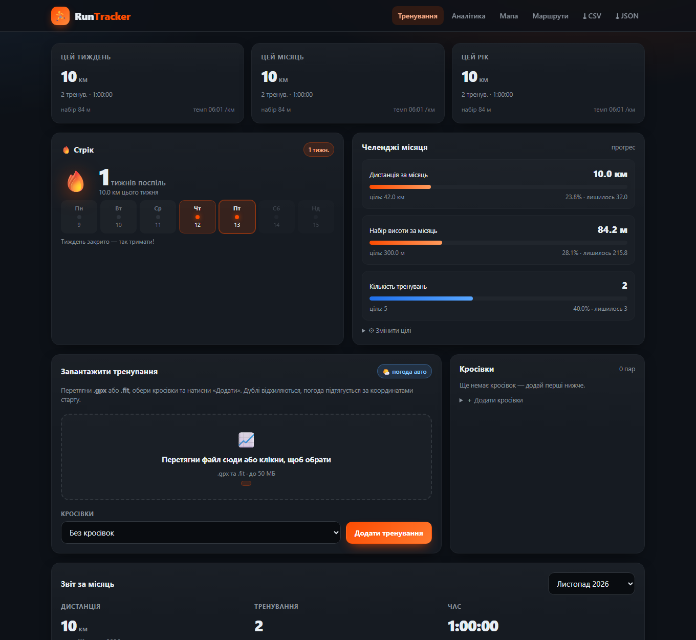

# RunTracker 3.0 🏃

Локальний веб-додаток для аналізу бігових тренувань — персональний аналог
**Strava Premium** без підписок і хмари. Усі дані зберігаються в SQLite на твоєму
комп'ютері, інтерфейс — темний, адаптивний, з PWA-режимом для телефона.



## Стек

- **Python 3.11+**, **FastAPI**, **SQLAlchemy 2.x**, **SQLite**
- **Jinja2** + власна темна CSS-тема (без Tailwind — працює офлайн)
- **Leaflet.js** — карти маршрутів / heatmap / конструктор
- **Chart.js** — темп і пульс, форма й втома
- **gpxpy** / **fitdecode** — розбір `.gpx` та `.fit`
- **PWA**: `manifest.json`, service worker, іконки 192/512
- Зовнішні безкоштовні API: **OSRM** (маршрути), **Open-Meteo** (погода та висоти)

## Швидкий старт (Windows, один клік)

Двічі клікни **`start.bat`**:

1. за потреби створить `.venv` і встановить залежності;
2. визначить локальну IP-адресу та покаже у консолі
   `Для відкриття з телефона у Wi-Fi: http://<IP>:8000`;
3. запустить сервер на `0.0.0.0:8000` (`--reload`);
4. через 2 секунди відкриє `http://127.0.0.1:8000` у браузері на ПК;
5. консоль лишається відкритою для логів (Ctrl+C — зупинити).

З телефона (в одній Wi-Fi-мережі) відкрий `http://<IP>:8000` з консолі. На iOS —
«Поділитися → На екран «Домівки»», на Android — меню Chrome «Встановити застосунок».
Якщо Windows Firewall запитає доступ — дозволь для приватних мереж.

Ручний запуск:

```powershell
cd runtracker
python -m venv .venv
.venv\Scripts\pip install -r requirements.txt
.venv\Scripts\python -m uvicorn app.main:app --host 0.0.0.0 --port 8000 --reload
```

Застосунок стартує **порожнім** — жодних демо-тренувань чи демо-кросівок.

## Структура

```
runtracker/
├── app/
│   ├── main.py          # роути: імпорт, CRUD, експорти, аналітика, heatmap, маршрути, погода
│   ├── models.py        # Activity (+file_hash, weather_json), Shoe, AppSettings
│   ├── db.py            # engine, init_db + безпечні ALTER-міграції
│   ├── parser.py        # GPX/FIT → точки, спліти, темп, пульс
│   ├── analytics.py     # стрік, челенджі, звіт за місяць, пульсові зони, CTL/ATL, PR, ACWR
│   ├── routing.py       # OSRM → геометрія, висоти Open-Meteo, генерація GPX
│   └── weather.py       # Open-Meteo: температура, вітер, опади на годину старту
├── templates/           # base, index, activity, activity_edit, shoe_edit,
│                        # analytics, heatmap, routes_builder
├── static/
│   ├── style.css        # темна тема (#0d1117 / #161b22 / #fc4c02), адаптив
│   ├── app.js           # drag&drop + реєстрація service worker
│   ├── manifest.json    # PWA
│   ├── sw.js            # офлайн-оболонка
│   └── icons/           # 192/512/svg
├── tools/
│   ├── stage3_test.py   # автотести етапу 3 (66 перевірок)
│   ├── smoke_test.py    # автотести етапу 2
│   ├── make_samples.py  # генератор прикладів .gpx/.fit
│   ├── make_icons.py    # генерація PWA-іконок (без Pillow)
│   └── lan_ip.ps1       # визначення LAN-IP для start.bat
├── sample_data/         # приклади треків
├── docs/                # скріншоти
├── AGENTS.md            # правила роботи в проєкті
├── start.bat
└── requirements.txt
```

## Можливості

### Імпорт і захист від дублів
- Drag-and-drop `.gpx`/`.fit`; оригінал зберігається в `uploads/`.
- Повторний імпорт відхиляється за **SHA-256** файлу або за збігом
  **часу старту (±60 с) + дистанції (±20 м)** — без запису в статистику й пробіг.
- Під час імпорту автоматично підтягується **погода** на годину старту
  (Open-Meteo: температура, вітер км/год, опади, WMO-опис) → бейдж у картці.

### Темп і графіки
- Темп скрізь у форматі `MM:SS /км` (картки, стрічка, спліти, тултіпи).
- Вісь темпу на графіку **інвертована**: швидше — вище.

### Стрік, челенджі, звіт
- **Стрік** 🔥: кількість тижнів поспіль із тренуваннями + сітка Пн–Нд
  з відмітками пробіжок (попередження, якщо тиждень ще не закрито).
- **Челенджі місяця**: дистанція, набір висоти, кількість тренувань —
  прогрес-бари, цілі редагуються (зберігаються в `app_settings`).
- **Звіт за місяць**: вибір місяця/року, сумарні показники та % порівняння
  з попереднім місяцем.

### Мапи
- Усі Leaflet-карти без треку центруються на **Київ / Троєщину (50.517, 30.605, zoom 13)**;
  тайли OSM затемнюються CSS-фільтром під темну тему.
- **`/heatmap`** — усі треки на одній карті, фільтр за роком/місяцем.
- **`/routes/builder`** — клік по карті додає точки, маршрут прокладається пішки
  через OSRM, висоти — Open-Meteo; рахуються дистанція, набір висоти, час;
  кнопка **«Завантажити .gpx»**.

### CRUD
- Тренування: редагування (назва, дата/час, кросівки) і видалення
  з автоматичним перерахунком пробігу взуття.
- Кросівки: створення (з початковим пробігом), редагування, архівування, видалення.

### Аналітика `/analytics`
1. **Пульсові зони Z1–Z5** — розподіл часу від max HR.
2. **Форма і втома (Fitness & Fatigue)** — CTL (42 дні), ATL (7 днів), TSB за 42 дні.
3. **Особисті рекорди** — найшвидші 1 / 5 / 10 / 21.1 / 42.2 км серед усіх треків.
4. **Відновлення** — **ACWR** (7 днів / 28 днів) зі статусом (Свіжий / Оптимально /
   Висока втома; «Мало даних», якщо історії < 2 тижнів) і текстовою порадою.

### Експорт
- **CSV** усієї історії (UTF-8 BOM, `;` — дружньо до Excel).
- **JSON-бекап** БД: кросівки + тренування з точками, сплітами й погодою.

## Міграції БД

`init_db()` створює відсутні таблиці та **обережно додає нові колонки**
(`file_hash`, `weather_json`) через `ALTER TABLE` у `try/except` — стара база
не ламається і дані не втрачаються.

## API

| Метод | Шлях | Призначення |
|---|---|---|
| GET | `/` | Головна: статистика, стрік, челенджі, звіт, стрічка |
| GET | `/analytics` | Пульсові зони, форма/втома, рекорди, ACWR |
| GET | `/heatmap?year=&month=` | Усі треки на одній карті |
| GET | `/routes/builder` | Конструктор маршрутів |
| POST | `/api/route` | OSRM-маршрут (JSON: `waypoints`) → дистанція, висоти, GPX |
| POST | `/upload` | Імпорт `.gpx`/`.fit` (+ погода, антидубль) |
| GET/POST | `/activities/{id}/edit` | Редагування тренування |
| POST | `/activities/{id}/delete` | Видалення з перерахунком км |
| POST | `/shoes`, `/shoes/{id}/edit|toggle|delete` | CRUD кросівок |
| POST | `/challenges/goals` | Цілі челенджів |
| GET | `/export/activities.csv` | Експорт CSV |
| GET | `/export/backup.json` | Бекап JSON |
| GET | `/manifest.json`, `/sw.js` | PWA-манифест і service worker |
| GET | `/healthz` | Health-check |

## Перевірка

```powershell
# сервер (тимчасово)
.venv\Scripts\python -m uvicorn app.main:app
# в іншому терміналі, на свіжій БД
.venv\Scripts\python tools\stage3_test.py     # 66 перевірок етапу 3
```

`stage3_test.py` покриває: рендер усіх сторінок, PWA-манифест/мета-теги/іконки,
темну палітру й адаптив, вміст і логіку `start.bat` (LAN IP, затримка 2 с),
імпорт GPX + погоду, антидублі, стрік, челенджі (збереження цілей), звіт за
місяць, аналітику (зони/CTL/ATL/PR/ACWR), heatmap з фільтрами,
`/api/route` (реальний OSRM + детермінований stub: дистанція/висоти/GPX),
**безпечну міграцію старої БД** (колонки + `app_settings`, дані не втрачено)
та 404. Окремо лишається `tools/smoke_test.py` (етап 2).

## Обмеження

- Один користувач, без авторизації (локальний застосунок).
- Карти/OSRM/Open-Meteo потребують інтернету; без мережі застосунок працює,
  але без тайлів і нової погоди (погода при імпорті просто пропускається).
- PWA-встановлення з телефона: на LAN-IP без HTTPS Chrome показує лише
  «Додати на головний екран» (ярлик); повний standalone-режим — на `localhost`.
- Спліти по 1 км; ручні кола/інтервали з файлу не читаються.
